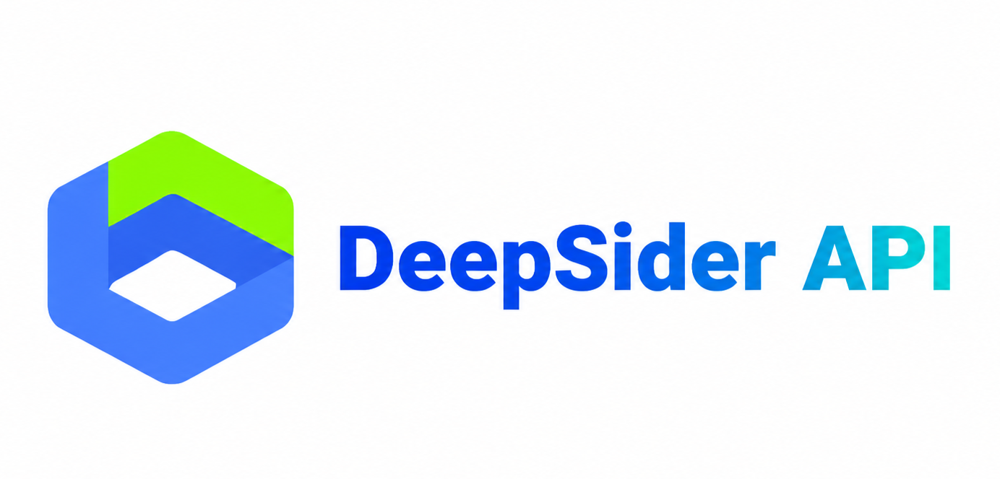
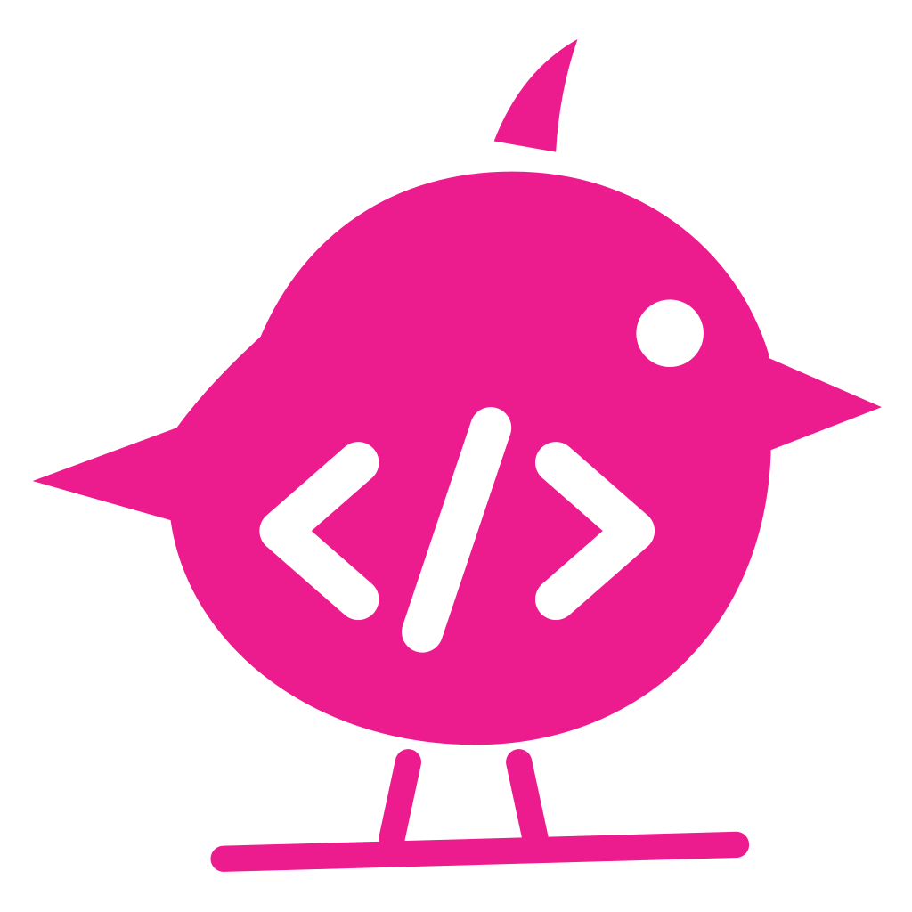

# CLIProxyAPI-EX 主要能力

## 开始使用

Core 负责请求路由、协议转换、接入调度与推理门禁。配合 CPA-Manager-Plus-ex 管理配置，配合 CPA-Usage-Keeper-ex 保存用量。

- 配置入口：[config.example.yaml](config.example.yaml)。完整上游说明见 [README-source.md](README-source.md)。
- 已确认的额度或余额耗尽由 Core 自动暂停：只阻断证据覆盖的接入、模型或钱包成员；后台拿到同一范围的最新有效证据才恢复。普通限流和运营低余额保护仍分别处理。
- 同一模型有多个接入时，可在配置的 `routing.provider-scheduling` 按模型或调用方启用统一调度。可先设 `shadow` 对照决策，再设 `enforce` 启用；默认关闭。
- 流已交付文本或工具调用，或无法确认可以安全重放时，不再透明切换接入。

需要 Go 1.26 或更高。在仓库根目录执行：

```powershell
go test ./...
go build -o cli-proxy-api.exe ./cmd/server
.\cli-proxy-api.exe --config config.yaml
```

本项目运行在本机 Windows。正式替换使用父项目的 `ops/deploy-local-cpa-core.ps1`，由脚本备份、重启、检查就绪状态，并在失败时自动回退。

## Fork 功能记录

本页只列相对上游 router-for-me/CLIProxyAPI 的主要功能。上游已经提供代理、账号轮换和协议转换，但资源身份、额度证据和上游异常恢复仍容易在边界处丢失；本 fork 将这些能力放进 Core 的统一门禁和运行时。

- **资源目录与身份围栏**：上游缺少一套贯穿资源发现、凭证主体和实际请求的身份绑定。本 fork 建立资源目录、能力协商和身份围栏，让额度查询、刷新和请求都只能使用当前已登记的真实来源。对应 [issue #23](https://github.com/williamxhero/CPA-Core-ex/issues/23)。
- **Provider 推理门禁与成员密钥核对**：上游对“哪个成员、哪把密钥、哪个 Provider”之间的对应关系验证不足。本 fork 在运行前校验成员与密钥匹配，并以门禁和路由权威阻止未确认的推理来源进入请求链。
- **原生凭证额度与 Credits 观测**：上游额度接口难以稳定表达选定凭证的滚动/周期窗口。本 fork 提供选定凭证的额度查询，接入 Qwen Coding Plan 的真实月度窗口，并把 Codex Credits 随同额度观测返回，避免用缺失窗口伪造零值。
- **按实际范围保护可用额度和余额**：已验证的 Codex 窗口和充值额度、DeepSeek 精确余额、DeepInfra 已验证的共享钱包分别按证据范围暂停。新鲜正向结果只解除对应原因；未覆盖的来源保留原有显示和保护，不用推理试余额。对应父项目 [#58](https://github.com/williamxhero/CPA/issues/58)。
- **官方 OpenAI 路由与模型参数兼容**：上游官方 API provider 可能因错误 executor、过期资源身份和较低优先级而根本没有被请求；`gpt-6.1-sol` 也要求 `max_completion_tokens` 而不是 `max_tokens`。本 fork 将 `api-wxh` 纳入 OpenAI-compatible 路由、重建有效资源身份并修正最终参数。参数兼容对应 [issue #24](https://github.com/williamxhero/CPA-Core-ex/issues/24)，资源身份问题由本节第一条归档。
- **reasoning effort 可追溯用量**：上游用量记录无法区分“客户端未指定 effort”和“数据在翻译阶段丢失”。本 fork 用 `auto` 表示未指定、保留 `none` 和具体 effort，并防止上游响应覆盖客户端已选值。对应 [issue #25](https://github.com/williamxhero/CPA-Core-ex/issues/25)。
- **容量错误与未完成流的内部恢复**：上游遇到容量错误或流在传输中断时通常直接把失败交给客户端。本 fork 在 Core 内对可重试的容量失败和未完成流进行有界重试，同时保留顺序、取消和最终错误语义。对应 [issue #1](https://github.com/williamxhero/CPA-Core-ex/issues/1)、[#26](https://github.com/williamxhero/CPA-Core-ex/issues/26)、[#27](https://github.com/williamxhero/CPA-Core-ex/issues/27) 和 [#29](https://github.com/williamxhero/CPA-Core-ex/issues/29)。
- **同模型统一选路和快返**：订阅与预付费接入在同一个候选池内，先筛模型、能力、资金权限与当前状态，再按优先级选路。允许的可用备用优先；完全无路且无预算内恢复机会时，立即返回 503/`no_available_route`。管理员可用响应关联号查询排除、实发与等待情况。对应父项目 [#59](https://github.com/williamxhero/CPA/issues/59)。
- **额度耗尽前的既有回退**：现有容量错误、流中断与凭证恢复保留各自的安全条件；未纳入统一调度范围的模型继续使用原策略。对应 [issue #22](https://github.com/williamxhero/CPA-Core-ex/issues/22) 和 [issue #28](https://github.com/williamxhero/CPA-Core-ex/issues/28)。
- **用量双通道分发**：上游用量入队容易在订阅采集与 HTTP 轮询之间二选一。本 fork 同一条已提交记录同时通知订阅者并提供 HTTP 轮询，Keeper 等外部采集器可以并行工作而不会互相截断。
- **插件宿主兼容**：上游在 Windows 非 cgo 场景下对插件能力的声明不完整。本 fork 保持插件能力与运行时身份的一致，避免宿主因为构建模式误判而拒绝已验证的插件。

本页只说明 EX fork 的增量；Core 的协议、配置和部署文档仍以仓库正文为准。

> 完成 issue 归档更新时间：2026-11-09 08:34:40 SGT（UTC+08:00）。已列入上述条目的 issue 后续不再重复归档。

---

<table>
<tbody>
<tr>
<td width="180"><a href="https://www.aicodemirror.ai/register?invitecode=TJNAIF"></a></td>
<td>Thanks to AICodeMirror for sponsoring this project! AICodeMirror provides official high-stability relay services for Claude Code / Codex / Gemini, with enterprise-grade concurrency, fast invoicing, and 24/7 dedicated technical support. Claude Code / Codex / Gemini official channels at 38% / 2% / 9% of original price, with extra discounts on top-ups! AICodeMirror offers special benefits for CLIProxyAPI users: register via <a href="https://www.aicodemirror.ai/register?invitecode=TJNAIF">this link</a> to enjoy 20% off your first top-up, and enterprise customers can get up to 25% off!</td>
</tr>
<tr>
<td width="180"><a href="https://apikey.fan/register?aff=CLIProxyAPI"></a></td>
<td>Thanks to APIKEY.FUN for sponsoring this project! APIKEY.FUN is a professional enterprise-grade AI relay platform dedicated to providing stable, efficient, and low-cost AI model API access for enterprises and individual developers. The platform supports popular mainstream models such as Claude, OpenAI, and Gemini, with prices as low as 7% of the official price. Register through this project's <a href="https://apikey.fan/register?aff=CLIProxyAPI">exclusive link</a> to enjoy a special <b>permanent 5% top-up discount</b>.</td>
</tr>
<tr>
<td width="180"><a href="https://api.fenno.ai/s/Cvf0"></a></td>
<td>FennoAI is a stable and efficient API relay service provider, currently focused on Codex relay services. It is compatible with OpenAI and Anthropic protocols and can flexibly integrate with mainstream coding tools such as Codex, Claude Code, and OpenCode. It can reliably support enterprise-grade demand of hundreds of billions of tokens per day, with B2B settlement and invoicing available for both domestic and overseas entities. FennoAI offers an exclusive benefit for CLIProxyAPI users: purchase a subscription through the <a href="https://api.fenno.ai/s/Cvf0">exclusive link</a> and receive $50 worth of Coding Plan credits for just $1.99. Referral rewards are also available: earn up to 20% commission when invited friends make a purchase. The more friends you invite, the greater the rewards.</td>
</tr>
<tr>
<td width="180"><a href="https://s.qiniu.com/7zUJri"></a></td>
<td>Thanks to <a href="https://s.qiniu.com/7zUJri">Qiniu Cloud AI</a> for sponsoring this project! Qiniu Cloud AI is an enterprise-grade large-model MaaS platform under Qiniu Cloud (02567.HK). It provides one-stop access to 150+ mainstream global models, is compatible with protocols from major global model providers, and covers full-modal processing capabilities for text, image, audio, video, and files. It serves more than 1.69 million enterprise and developer users. Exclusive benefits: enterprise users can claim 12 million free tokens, and invite friends to earn up to tens of billions of tokens.</td>
</tr>
<tr>
<td width="180"><a href="https://cubence.com/signup?code=CLIPROXYAPI&source=cpa"></a></td>
<td>Thanks to Cubence for sponsoring this project! Cubence is a reliable and efficient API relay service provider, offering relay services for Claude Code, Codex, Gemini, and more. Cubence provides special discounts for our software users: register using <a href="https://cubence.com/signup?code=CLIPROXYAPI&source=cpa">this link</a> and enter the "CLIPROXYAPI" promo code during recharge to get 10% off.</td>
</tr>
<tr>
<td width="180"><a href="https://bestproxy.com/?keyword=ayh7otlb"></a></td>
<td>Bestproxy provides high-purity residential IPs with dedicated one-IP-per-account support. 🟡Residential Proxy - &#36;0.5/GB；🟡Static Residential Proxy - Starting at &#36;3/IP；🟡Unlimited Residential Proxy - Starting at &#36;67/Day.  ✅<a href="https://bestproxy.com/?keyword=ayh7otlb">Get Free Trial.</a></td>
</tr>
<tr>
<td width="180"><a href="https://www.swiftproxy.net/?code=PR67S9A95"></a></td>
<td>Swiftproxy provides 90M+ clean residential IPs across 220+ locations, supporting HTTP(S)/SOCKS5, IP rotation, Sticky Sessions, and precise location targeting. It helps AI API tools and automation workflows access online services reliably from different locations, making it ideal for API requests, web access, data collection, and location-based testing. Residential proxies from &#36;0.7/GB. Free testing is available, with 10% off using code PROXY90. <a href="https://www.swiftproxy.net/?code=PR67S9A95">Try Swiftproxy Now</a></td>
</tr>
<tr>
<td width="180"><a href="https://www.rapidproxy.io/?code=KHM9B6E6M"></a></td>
<td><a href="https://www.rapidproxy.io/?code=KHM9B6E6M">RapidProxy</a> is a high-performance proxy provider built for automation and multi-account operations, offering clean residential proxies and native static ISP IPs. With 90M+ residential IPs worldwide, smart rotation, stable sessions, and high-concurrency support, RapidProxy is ideal for web scraping, browser automation, social media account management, e-commerce operations, bulk account registration, and more. Residential proxies start at just &#36;0.55/GB, with traffic that never expires. Use code RAPID10 for 10% off, and <a href="https://www.rapidproxy.io/?code=KHM9B6E6M">start your free trial today.</a></td>
</tr>
<tr>
<td width="180"><a href="https://pateway.ai/?ch=jjvdb"></a></td>
<td>PatewayAI is an API relay service provider for experienced AI developers, with full support for the Claude and Codex model families. All models come from high-quality official channels, with no dilution or counterfeiting, and transparent, verifiable billing details. Economy mode starts at just 5% of the official price. Register through <a href="https://pateway.ai/?ch=jjvdb">this link</a> to receive trial credits and participate in occasional promotions for free credits. The platform also supports enterprise-grade concurrency, a dedicated management dashboard, formal contracts and invoices, and two-way referral rewards of up to &#36;150.</td>
</tr>
<tr>
<td width="180"><a href="https://kedaya.ai/register?aff=824X8RAHCYXM"></a></td>
<td>kedaya.ai is a stable and efficient AI model API relay service provider, covering leading models including Claude, GPT, Gemini, Grok, Antigravity, and DeepSeek. It supports native OpenAI (including Responses), Anthropic, and Gemini protocols, enabling seamless integration with clients such as CLIProxyAPI, Claude Code, Codex, Gemini CLI, and Grok CLI. OpenAI and Grok model prices can be as low as 0.1% of official rates! <a href="https://kedaya.ai/register?aff=824X8RAHCYXM">Exclusive registration link</a>.</td>
</tr>
<tr>
<td width="180"><a href="https://xcode.best/register?aff=OuDv"></a></td>
<td>
    🥚 <b>[Freebie Alert!] Register & submit a ticket with code to grab $5 free credit + 15% OFF first top-up!</b><br>
    🚀 <b>More than just API routing — an all-in-one Web workspace:</b> Enjoy Web chat, AI image generation, video creation, and automated workflows right out of the box without any frontend setup.<br>
    ⚡ <b>All mainstream models supported:</b> High-speed routing for Claude, GPT, Gemini, DeepSeek, and more.<br>
    🛡️ <b>Reliable guarantees:</b> Hassle-free refunds | Official invoicing | B2B & individual billing | High-availability customer support ready to help!<br><br>
    👉 Xcode VIP Portal: <a href="https://xcode.best/register?aff=OuDv">https://xcode.best</a><br>
    💬 Ticket Code: <code>CLIProxyAPI</code> (Submit a ticket to claim your credits instantly)
  </td>
</tr>
<tr>
<td width="180"><a href="https://x.com/chenju_ai"></a></td>
<td>Thanks to <a href="https://x.com/chenju_ai">陈局 (Chenju)</a> for sponsoring this project! Probably the only slot here that won't ask you to sign up — no signup link, no promo code. Just raising a glass to the maintainers, because good open source deserves to be paid for. Come shoot the breeze on X: <a href="https://x.com/chenju_ai">@chenju_ai</a></td>
</tr>
<tr>
<td width="180"><a href="https://www.deepsiderapi.com/?utm_source=CLIProxyAPI"></a></td>
<td>Access leading AI models like GPT, Claude, Gemini, and DeepSeek—all in one place. We connect through official channels from major providers, with no shared account pools or reverse engineering. Save up to 71% compared with official rates. Track your usage in real time with transparent billing, and access AI at a lower cost. <a href="https://www.deepsiderapi.com/?utm_source=CLIProxyAPI">Try DeepSider API</a>.</td>
</tr>
<tr>
<td width="180"><a href="https://origincoder.com/"></a></td>
<td><strong><a href="https://origincoder.com">OriginCoder</a> is an enterprise-grade AI gateway designed for low latency, reliability, and high concurrency.</strong> <strong>We build and operate our Claude Max and GPT Pro account pools entirely in-house. Pools that maintain full model performance are priced at 30–40% of official rates, and we publish each pool’s performance status in real time.</strong> Access <strong>GPT, Claude, Grok, Gemini-4-Carbon, DeepSeek, and other leading AI models</strong> through coding tools such as <strong>Claude Code and Codex</strong>. Use it for <strong>AI chat, coding assistance, image generation, and video generation</strong>. We operate overseas in compliance with local regulations and have <strong>served more than 15,000 customers since launching in August 2025</strong>. Our pricing is transparent, with <strong>no overage fees and top-ups starting at CNY 10</strong>. We keep the service running smoothly during peak hours through <strong>24/7 monitoring, redundant account pools, and automatic failover between nodes</strong>. <a href="https://origincoder.com/monitor">Check our service status</a>. <strong>We protect your privacy by not storing conversation content.</strong> We support <strong>business payments and invoicing</strong>. Our support team <strong>responds within 3 minutes</strong>, and our technical team is available <strong>24/7</strong>. Users in mainland China can connect through our <a href="https://cn.origincoder.com">China-optimized gateway</a>.</td>
</tr>
<tr>
<td width="180"><a href="https://visioncoder.cn/"></a></td>
<td><strong><a href="https://visioncoder.cn/">VisionCoder</a> | China’s OpenRouter — one API for leading Chinese and global AI models.</strong> Access <strong>DeepSeek, Qwen, Kimi, GLM, GPT, Claude, Gemini, and Grok</strong>, with intelligent routing across suppliers and automatic failover. <strong>Failed requests are free, pricing is public, and every charge can be verified.</strong> Works with coding tools such as Claude Code and Codex, with <strong><a href="https://visioncoder.cn/me/keys">one-click import into CC Switch and WorkBuddy</a></strong>. Teams can purchase centrally, assign subscription packages by seat, and reclaim them for reassignment, with business bank transfers and invoicing supported. <strong>Supplier applications are open: list your model endpoints and earn traffic based on quality. Monthly settlement to business bank accounts, itemized usage records, and customer billing and invoicing handled by VisionCoder.</strong> Join the <a href="https://visioncoder.cn/challenge">VibeCoding Challenge</a> for <strong>CNY 2,350 in top-up credits per round</strong>, including <strong>CNY 1,000 in top-up credits for first place</strong>.</td>
</tr>
</tbody>
</table>

## Overview

- OpenAI/Gemini/Claude/Grok compatible API endpoints for CLI models
- OpenAI Codex support (GPT models) via OAuth login
- Claude Code support via OAuth login
- Grok Build support via OAuth login
- Streaming, non-streaming, and WebSocket responses where supported
- Function calling/tools support
- Multimodal input support (text and images)
- Multiple accounts with round-robin load balancing (Gemini, OpenAI, Claude, Grok)
- Simple CLI authentication flows (Gemini, OpenAI, Claude, Grok)
- Generative Language API Key support
- AI Studio Build multi-account load balancing
- Claude Code multi-account load balancing
- OpenAI Codex multi-account load balancing
- Grok Build multi-account load balancing
- OpenAI-compatible upstream providers via config (e.g., OpenRouter)
- Reusable Go SDK for embedding the proxy (see `docs/sdk-usage.md`)

## Getting Started

CLIProxyAPI Guides: [https://help.router-for.me/](https://help.router-for.me/)

[Claude Code with a Codex backend](examples/claude-code-codex/README.md): optional visible progress, classifier routing, image-tool pass-through, and latency diagnostics.

## Management API

see [MANAGEMENT_API.md](https://help.router-for.me/management/api)

## Usage Statistics

Since v6.10.0, CLIProxyAPI and [CPAMC](https://github.com/router-for-me/Cli-Proxy-API-Management-Center) no longer ship built-in usage statistics. If you need usage statistics, use:

### [CPA Usage Keeper](https://github.com/Willxup/cpa-usage-keeper)

Standalone persistence and visualization service for CLIProxyAPI, with periodic data sync, SQLite storage, aggregate APIs, and a built-in dashboard for usage and statistics.

### [CPA-Manager-Plus](https://github.com/seakee/CPA-Manager-Plus)

A self-hosted CLIProxyAPI management console and observability dashboard, available as a lightweight drop-in panel or a full Manager Server with persistent analytics. Manage OAuth credentials, AI providers, client API keys, model aliases, plugins, and CPA settings in one interface. SQLite-backed request history enables live monitoring, failure diagnosis, and token, latency, and estimated-cost breakdowns by model, provider, account, key, and channel. Supports editable model prices and one-click price sync, alongside Codex and xAI quota checks, reset information, account-health inspection, and controlled recovery actions. Deploy via Docker or cross-platform native packages, with data stored locally.

### [Oh-My-CPA](https://github.com/WizisCool/oh-my-cpa)

Web console for CLIProxyAPI v8+, built on `shadcn/ui` with a modern UI/UX, fluid motion, and desktop and mobile layouts. Centralizes providers, OAuth, visual routing, and built-in plugins, with comprehensive request records (latency, TTFT, tokens, diagnostics, and model substitutions), live routing, multi-dimensional pricing analytics, quota window warmup and forecasting, and Agent/MCP tools. Protected by AES-GCM encryption and automatic config backups, supporting direct binary runs, Docker deployment, and one-click OMC/CPA updates.

## SDK Docs

- Usage: [docs/sdk-usage.md](docs/sdk-usage.md)
- Advanced (executors & translators): [docs/sdk-advanced.md](docs/sdk-advanced.md)
- Access: [docs/sdk-access.md](docs/sdk-access.md)
- Watcher: [docs/sdk-watcher.md](docs/sdk-watcher.md)
- Custom Provider Example: `examples/custom-provider`

## Contributing

Contributions are welcome! Please feel free to submit a Pull Request.

1. Fork the repository
2. Create your feature branch (`git checkout -b feature/amazing-feature`)
3. Commit your changes (`git commit -m 'Add some amazing feature'`)
4. Push to the branch (`git push origin feature/amazing-feature`)
5. Open a Pull Request

## Who is with us?

Those projects are based on CLIProxyAPI:

### [vibeproxy](https://github.com/automazeio/vibeproxy)

Native macOS menu bar app to use your Claude Code & ChatGPT subscriptions with AI coding tools - no API keys needed

### [Subtitle Translator](https://github.com/VjayC/SRT-Subtitle-Translator-Validator)

A cross-platform desktop and web app to translate and validate SRT subtitles using your existing LLM subscriptions (Gemini, ChatGPT, Claude, etc.) via CLIProxyAPI - no API keys needed.

### [CCS (Claude Code Switch)](https://github.com/kaitranntt/ccs)

CLI wrapper for instant switching between multiple Claude accounts and alternative models (Gemini, Codex, Antigravity) via CLIProxyAPI OAuth - no API keys needed

### [Quotio](https://github.com/nguyenphutrong/quotio)

Native macOS menu bar app that unifies Claude, Gemini, OpenAI, and Antigravity subscriptions with real-time quota tracking and smart auto-failover for AI coding tools like Claude Code, OpenCode, and Droid - no API keys needed.

### [ProxyPilot](https://github.com/Finesssee/ProxyPilot)

Windows-native CLIProxyAPI fork with TUI, system tray, and multi-provider OAuth for AI coding tools - no API keys needed.

### [CPA-XXX Panel](https://github.com/ferretgeek/CPA-X)

A lightweight web admin panel for CLIProxyAPI with health checks, resource monitoring, real-time logs, auto-update, request statistics and pricing display. Supports one-click installation and systemd service.

### [CLIProxyAPI Tray](https://github.com/kitephp/CLIProxyAPI_Tray)

A Windows tray application implemented using PowerShell scripts, without relying on any third-party libraries. The main features include: automatic creation of shortcuts, silent running, password management, channel switching (Main / Plus), and automatic downloading and updating.

### [霖君](https://github.com/wangdabaoqq/LinJun)

霖君 is a cross-platform desktop application for managing AI programming assistants, supporting macOS, Windows, and Linux systems. Unified management of Claude Code, Gemini, OpenAI Codex, and other AI coding tools, with local proxy for multi-account quota tracking and one-click configuration.

### [CLIProxyAPI Dashboard](https://github.com/itsmylife44/cliproxyapi-dashboard)

A modern web-based management dashboard for CLIProxyAPI built with Next.js, React, and PostgreSQL. Features real-time log streaming, structured configuration editing, API key management, OAuth provider integration for Claude/Gemini/Codex, usage analytics, container management, and config sync with OpenCode via companion plugin - no manual YAML editing needed.

### [All API Hub](https://github.com/qixing-jk/all-api-hub)

Browser extension for one-stop management of New API-compatible relay site accounts, featuring balance and usage dashboards, auto check-in, one-click key export to common apps, in-page API availability testing, and channel/model sync and redirection. It integrates with CLIProxyAPI through the Management API for one-click provider import and config sync.

### [Shadow AI](https://github.com/HEUDavid/shadow-ai)

Shadow AI is an AI assistant tool designed specifically for restricted environments. It provides a stealthy operation
mode without windows or traces, and enables cross-device AI Q&A interaction and control via the local area network (
LAN). Essentially, it is an automated collaboration layer of "screen/audio capture + AI inference + low-friction delivery",
helping users to immersively use AI assistants across applications on controlled devices or in restricted environments.

### [ProxyPal](https://github.com/buddingnewinsights/proxypal)

Cross-platform desktop app (macOS, Windows, Linux) wrapping CLIProxyAPI with a native GUI. Connects Claude, ChatGPT, Gemini, GitHub Copilot, and custom OpenAI-compatible endpoints with usage analytics, request monitoring, and auto-configuration for popular coding tools - no API keys needed.

### [CLIProxyAPI Quota Inspector](https://github.com/AllenReder/CLIProxyAPI-Quota-Inspector)

Ready-to-use cross-platform quota inspector for CLIProxyAPI, supporting per-account codex 5h/7d quota windows, plan-based sorting, status coloring, and multi-account summary analytics.

### [CLIProxy Pool Watch](https://github.com/murasame612/CLIProxyPoolWidget)

Native macOS SwiftUI app for monitoring ChatGPT/Codex account quotas in CLIProxyAPI pools. Displays account availability, Plus-base capacity, 5-hour and weekly quota bars, plan weights, and restore forecasts through the Management API.

### [Panopticon](https://github.com/eltmon/panopticon-cli)

Multi-agent orchestration for AI coding assistants. Runs CLIProxyAPI as a local sidecar so its agents can drive GPT models through a ChatGPT subscription, pointing Claude Code at an Anthropic-compatible endpoint with no OpenAI API key required.

### [Tunnel Agent](https://github.com/Villoh/tunnel-agent)

Windows desktop UI that manages CLIProxyAPI and Perplexity WebUI Scraper from a single interface, inspired by Quotio and VibeProxy. Connect OAuth providers (Claude, Gemini, Codex, Kimi, Antigravity), custom API keys, and Perplexity session accounts, then point any coding agent at the local endpoint.

### [Quotio Desktop](https://github.com/xiaocoss/quotio-desktop)

Cross-platform (Tauri) port of Quotio for Windows, macOS and Linux. Manages a pool of AI accounts (Codex, Claude Code, GitHub Copilot, Gemini, Antigravity, Kiro, Cursor, Trae, GLM) through CLIProxyAPI, with per-account 5-hour/weekly quota bars, Codex rate-limit reset credits with one-click reset, smart scheduling, usage statistics, and multi-instance Codex — no API keys needed.

### [Universal Chat Provider](https://github.com/maxdewald/vscode-universal-chat-provider)

VS Code extension that brings your Claude, ChatGPT/Codex, Antigravity, Grok, and Kimi subscriptions into GitHub Copilot Chat as native language models — and can power your Git commit messages, chat titles, and summaries too. Runs CLIProxyAPI in a fully managed background lifecycle (download, verify, supervise) shared across all windows, so it's zero-setup. No API keys needed, just OAuth.

### [CPA-Tray-Powershell](https://github.com/ztzpro/CPA-Tray-Powershell.git)

A PowerShell-based Windows system tray launcher for CLIProxyAPI. It supports running in the background without a console window, opening the management page, keeping the backend running after the management window closes, and reopening the page from the tray. It also supports checking for CLIProxyAPI updates on startup, SHA-256 verification with rollback, one-click CLIProxyAPI restart and update, PID-validated process management, and safe service shutdown.

### [Grok Search MCP](https://github.com/MapleMapleCat/Grok_Search_Mcp)

An HTTP-only Model Context Protocol server that uses a CLIProxyAPI deployment to provide Grok-powered real-time web search, X/Twitter search, and model discovery to MCP clients. It adds MCP transport, client API-key management, quotas, usage tracking, and a web administration panel.

### [AIUsage](https://github.com/sylearn/AIUsage)

Native macOS SwiftUI dashboard for AI subscriptions and coding proxies. It manages official CLIProxyAPI releases end to end (download, verify, supervise, update, and roll back), unifies OAuth accounts and live models, and connects one gateway to Codex, Claude Code/Science, OpenCode, or OpenAI/Anthropic/Gemini clients, with optional LAN access.

### [Claude Dialects](https://github.com/stefandevo/claude-dialects)

Run multiple native-feeling Claude Code commands, each powered by a different model (Codex, GLM, Kimi, Gemini, Grok, MiniMax, DeepSeek, Cursor, Copilot, Claude). Every dialect launches the real Claude Code interface with its own isolated config, history, ports, and an embedded CLIProxyAPI instance linked through the Go SDK — no separate proxy install. macOS only. Learn more at [claude-dialects.cc](https://claude-dialects.cc/).

### [WebBrain](https://github.com/webbrain-one/webbrain)

Browser agent that can connect to CLIProxyAPI's local OpenAI-compatible endpoint as a model provider. See WebBrain's independent [setup, security, and account-risk guide](https://webbrain.one/docs/easy-cli-proxy/) for using CLIProxyAPI through EasyCLIProxyAPI.

### [Infinitus](https://github.com/deathemperor/infinitus)

Native macOS menu bar app that runs a fleet of Claude accounts through CLIProxyAPI's Management API (claude-swap and 9Router too): 5h / 7d / per-model quota gauges, switch / hold / star from the popup, a run-rate forecast of when each window runs out, and an iPhone companion that mirrors it all - no API keys needed.

### [PiCloud](https://github.com/cookerpapa/pi-cloud)

Self-hosted coding-agent platform built on the Pi SDK, with a web UI, concurrent subagents, and CubeSandbox KVM workspaces. Uses CLIProxyAPI as its provider gateway, keeping provider credentials outside the guest workspaces.

### [cc-status-line](https://github.com/kinka/cc-status-line)

Claude Code status line for CLIProxyAPI: per-account Codex / Grok / Antigravity / Claude quotas (5h / 7d / weekly) and reset countdown for the current instance. Picks the CPA instance from `ANTHROPIC_BASE_URL` and reads quotas through the Management API.

### [CLIProxy Quota Tray](https://github.com/ZYHUO/CLIProxy-Quota-Tray)

Cross-platform Electron tray dashboard for CLIProxyAPI. Shows the real OAuth quota windows per account across ChatGPT/Codex, Claude, Gemini/Antigravity, Grok, Kimi and Cursor, estimates usage-queue cost, and tracks OpenAI/Claude service status. Dark terminal-style UI; runs on Windows and Linux.

### [panel4cliproxyapi](https://github.com/yaanlaan/panel4cliproxyapi)

A modern, responsive web dashboard and management console for CLIProxyAPI built with React and Tailwind CSS. Features multi-provider OAuth login with LAN redirect assistance, visual zero-YAML configuration, real-time traffic analytics charts, client API key management, core version checking & hot-reloading, and a live SSE streaming playground.

### [sub2api](https://github.com/PlaygrndLabs/sub2api)

A Cloudflare-based LLM gateway and proxy server: CLIProxyAPI deployed to Cloudflare Workers + Containers in one click. Logins and config persist in R2, the dashboard sits behind a password, and API calls are refused until a client API key exists.

### [Hermes CLIProxyAPI Provider](https://github.com/duu261/hermes-cliproxyapi-provider)

Model-provider plugin for [Hermes Agent](https://github.com/NousResearch/hermes-agent) that registers one Hermes provider per CLIProxyAPI provider, each on the wire its executor accepts (Anthropic Messages, Responses or Chat Completions), with context windows and reasoning levels read from CLIProxyAPI. Optional read-only Management API pass for exact provider grouping. A companion plugin adds a `/cpa` chat command for each pool's account health and, on request, each account's live quota. Listed in the [Hermes plugin catalog](https://hermes-agent.nousresearch.com/docs/plugins): `hermes plugins install cliproxyapi-provider` and `hermes plugins install cpa-status`.

### [Ebb](https://github.com/lucasnsaraujo/ebb)

Native macOS menu bar app for CLIProxyAPI pools. It shows how much of the pool's Claude, Codex and other providers' 5-hour and weekly limits is left and when it comes back, and sets each login's routing weight through the Management API so the accounts drain evenly.

### [Nia Live Demo](https://github.com/nia-teams/nia-live-demo)

Real-time full-duplex voice companion with a live, interactive SVG/HTML canvas. It combines two CLIProxyAPI capabilities: the Codex GPT-Live 1.1 media relay (`gpt-live-1-codex`, WebRTC + Sideband) for voice with instant barge-in, and `ultrafast` Responses (`gpt-6.1-sol` / `gpt-6-astra`) for drawing and editing the canvas while you talk.

### [Hyphantria](https://hyphantria.com)

Native macOS schematic and PCB design app with AI-assisted component creation, reference-design adoption, and joint placement and routing optimisation. Natively supports CLIProxyAPI for connecting its AI-assisted features to your AI providers.

> [!NOTE]
> If you developed a project based on CLIProxyAPI, please open a PR to add it to this list.

## More choices

Those projects are ports of CLIProxyAPI or inspired by it:

### [9Router](https://github.com/decolua/9router)

A Next.js implementation inspired by CLIProxyAPI, easy to install and use, built from scratch with format translation (OpenAI/Claude/Gemini/Ollama), combo system with auto-fallback, multi-account management with exponential backoff, a Next.js web dashboard, and support for CLI tools (Cursor, Claude Code, Cline, RooCode) - no API keys needed.

### [OmniRoute](https://github.com/diegosouzapw/OmniRoute)

Never stop coding. Smart routing to FREE & low-cost AI models with automatic fallback.

OmniRoute is an AI gateway for multi-provider LLMs: an OpenAI-compatible endpoint with smart routing, load balancing, retries, and fallbacks. Add policies, rate limits, caching, and observability for reliable, cost-aware inference.

### [Codex Switch](https://github.com/9ycrooked/CodexSwitch)

This is a tool built with Tauri 2 + Vue 3 for managing multiple OpenAI Codex desktop accounts. Switch between saved ChatGPT/Codex certification profiles, check 5-hour and weekly quota usage in real time, verify token health, view active account details, and import or save auth.json files without manual copying.

### [cliproxy-rs](https://github.com/vayungodara/cliproxy-rs)

A Rust port of CLIProxyAPI that reads the same `config.yaml` and auth files and serves the same routes and v8 Management API, so you can switch between the two in either direction. Ships as a single binary with the management dashboard built in (per-account 5-hour and weekly quota view, account sign-in, client setup guides), and adds an opt-in `soonest-reset` routing strategy that spends the account whose weekly window resets first.

> [!NOTE]
> If you have developed a port of CLIProxyAPI or a project inspired by it, please open a PR to add it to this list.

## License

This project is licensed under the MIT License - see the [LICENSE](LICENSE) file for details.
